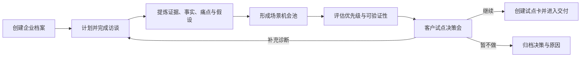

# FDE 企业服务工作台 MVP PRD

**版本**：v0.1（草案）  
**日期**：2026-08-13  
**状态**：待评审  
**产品负责人**：待定  
**目标用户**：为企业提供 AI 咨询、诊断、试点与陪跑服务的 FDE 团队

---

## 1. 产品摘要

FDE 企业服务工作台是团队内部使用的企业服务运营系统。它帮助 FDE 团队把一次企业服务从模糊线索，推进到完成访谈诊断、明确高价值场景、与客户共同确认试点，再进入后续交付。

第一版只解决一个核心问题：**团队能否在 2—4 周内，基于真实访谈，将一家企业从“想做 AI”推进到“有明确业务问题、双方 Owner、试点范围、价值指标和验收方式”的可启动试点。**

产品不是通用 CRM，也不是研发项目管理工具。其核心价值是让访谈证据、诊断判断、客户承诺和试点决策形成一条可信、可执行的链路。

## 2. 背景与问题

### 2.1 FDE 服务的工作本质

FDE 服务不是销售一个孤立的 AI 工具，而是连接四类工作：

```text
业务诊断 → 流程重构 → AI / Agent 试点 → 组织采用与持续优化
```

客户最终购买的是降低转型不确定性与获得业务结果，而非一份方案或一个聊天机器人。FDE 需要同时与高管、业务负责人、一线员工、IT/数据部门协作，识别业务损失、还原真实工作流、判断技术与人工边界，并推动客户做出试点决策。

### 2.2 当前痛点

目前的企业服务信息通常散落在会议纪要、聊天记录、文档、表格和个人脑中，造成：

1. 访谈完成后，团队难以区分客户原话、FDE 判断与仍待验证的假设。
2. 高管目标、业务痛点、一线实际流程和数据权限约束无法被放在同一处对照。
3. 需求容易直接变成“做一个 Agent”，缺少问题证据、业务 Owner、价值基线和验收标准。
4. 客户承诺与内部待办分散，关键决策节点容易被遗漏。
5. 团队无法快速判断：哪家企业卡住了、卡在哪里、下一步由谁推动。

### 2.3 产品机会

以“企业—访谈证据—场景机会—试点决策”为主线，把 FDE 的诊断方法固化为轻量流程。第一版先让团队可靠地完成诊断和试点启动；项目交付、长期陪跑、知识库与财务管理在后续阶段扩展。

## 3. 目标、成功指标与边界

### 3.1 产品目标

1. 让每家诊断中的企业都有统一、可追溯的服务状态和下一步。
2. 让 FDE 能从访谈和现场观察中形成结构化证据、假设和问题。
3. 让团队可对比多个候选场景，并推动客户完成一次正式试点决策。
4. 让管理者在首页看到企业风险、责任归属和团队当周优先级。

### 3.2 成功指标

| 指标 | 第一版目标 | 口径 |
|---|---:|---|
| 诊断企业的“下一步”覆盖率 | ≥ 90% | 每家非结束状态企业均有负责人、动作、截止日 |
| 关键角色访谈完成率 | ≥ 80% | 高管、业务、IT/数据、一线四类角色中已完成的比例 |
| 从诊断启动到试点决策周期 | ≤ 4 周 | 首次访谈日至客户确认试点/明确不做 |
| 试点卡完整率 | 100% | 已启动试点具备范围、Owner、基线、目标、验收和边界 |
| 访谈行动项转化率 | ≥ 70% | 访谈中确认的行动项已创建并进入跟进 |

### 3.3 非目标

第一版不做以下内容：

- 完整 CRM（商机、合同、回款、销售漏斗）；
- 甘特图、工时、研发 Issue 或供应商管理；
- 客户可登录的门户；
- 企业知识库、RAG、Agent 编排与自动化执行；
- 录音转写、自动同步飞书/企微/Jira 等外部集成；
- 复杂 BI、项目利润核算和长期陪跑运营。

这些能力可由现有 CRM、飞书、Notion、Jira 或表格暂时承接。第一版只保留人工录入和人工确认后的结构化状态。

## 4. 用户与使用场景

### 4.1 用户角色

| 角色 | 主要任务 | 权限需求 |
|---|---|---|
| FDE / 顾问 | 建企业档案、计划与记录访谈、提炼洞察、推动试点 | 负责企业的完整读写 |
| FDE 负责人 | 分配企业、查看风险、审核诊断和试点准备度 | 全局查看；重点字段编辑 |
| 交付协作成员 | 补充技术、数据、集成与权限判断 | 被加入企业后可编辑指定内容 |
| 管理者 | 管理团队负载、风险和关键决策 | 跨企业查看；不默认查看敏感原始材料 |

### 4.2 关键场景

1. FDE 新接手一家企业，建立服务档案，明确客户关键人和当前阶段。
2. FDE 访谈客户高管、业务负责人、一线员工和 IT/数据负责人，记录原话、事实、痛点与待验证假设。
3. 团队将访谈洞察收敛为场景机会，判断是否值得做 MVP。
4. FDE 召开蓝图/试点决策会，确认范围、双方 Owner、数据权限、人工边界、指标和验收方式。
5. 负责人在首页识别卡点，例如“未访谈业务 Owner”“数据权限未确认”“试点无验收基线”。

## 5. 核心流程



### 5.1 企业状态

| 状态 | 定义 | 进入条件 | 退出条件 |
|---|---|---|---|
| 待诊断 | 已确认服务机会，尚未开始访谈 | 建立企业档案 | 首场访谈已完成 |
| 诊断中 | 正在理解目标、流程、数据和约束 | 至少一场访谈完成 | 候选场景已形成 |
| 待试点决策 | 已具备诊断结论，等待客户确认 | 至少一个场景达到决策准备度 | 继续、补充诊断或暂不做 |
| 已启动试点 | 双方已确认试点卡 | 试点卡完整 | 后续版本承接交付状态 |
| 暂停/结束 | 客户或团队决定不继续 | 已记录决策原因 | 如重新启动，回到待诊断 |

## 6. 第一版信息架构与页面

### 6.1 页面总览

```text
工作台首页
企业列表
企业作战页
  ├─ 概览
  ├─ 访谈与诊断
  └─ 场景机会与试点决策
```

“企业作战页”是企业信息的唯一聚合入口；第一版不为交付、知识库、财务等建立独立一级模块。

### 6.2 页面一：工作台首页（P0）

**目标**：让团队每天快速找到最需要推进的企业和明确下一步。

**功能**：

- 我的待办：访谈、客户承诺、内部协作、临期行动项；
- 诊断漏斗：待诊断、诊断中、待试点决策、已启动试点的企业数量；
- 风险清单：关键角色未访谈、客户资料待补、数据/权限未确认、无业务 Owner、无验收指标、行动项逾期；
- 企业关注列表：企业、阶段、健康状态、下一个决策门、负责人、下一步；
- 快速操作：新建企业、新建访谈、创建行动项。

**不做**：大屏 BI、跨项目工时统计、自动健康分。

### 6.3 页面二：企业列表（P0）

**目标**：让负责人按状态和责任快速管理企业组合。

**字段**：企业名称、行业、服务模式、阶段、FDE Owner、客户决策人、业务 Owner、当前核心问题、下一个节点、健康状态、最后更新时间。

**功能**：

- 搜索企业；
- 按阶段、Owner、行业、风险筛选；
- 新建企业；
- 从列表直接查看“缺失关键条件”。

### 6.4 页面三：企业作战页—概览（P0）

**目标**：成为团队判断该企业现状的唯一可信页面。

**内容区块**：

1. 顶部状态：企业阶段、健康状态、FDE Owner、下一个决策门与日期。
2. 服务目标：客户为何做 AI、优先解决的业务问题、预期业务结果。
3. 关键人地图：决策人、业务 Owner、IT/数据 Owner、一线代表；显示角色、态度、影响力、是否已访谈。
4. 当前结论：已确认事实、最高优先级风险、正在验证的假设。
5. 行动项：客户待办与内部待办，均有负责人、截止日、状态和来源。
6. 诊断准备度：访谈覆盖、场景数量、数据权限状态、试点卡完整度。

### 6.5 页面四：访谈与诊断（P0）

**目标**：把访谈从“会议纪要”变成可追溯的诊断证据。

#### A. 访谈计划

- 新建访谈：企业、访谈对象、对象角色、时间、访谈目标、待验证假设、所需材料、内部负责人；
- 预置角色：高管/老板、业务负责人、一线员工、IT/数据负责人、财务/运营；
- 显示四类关键角色是否完成访谈；
- 未完成或逾期的访谈进入首页风险清单。

#### B. 访谈记录

一条访谈记录包含：

- 基础信息：访谈对象、角色、日期、参与 FDE、时长；
- 原始记录：笔记、转写文本或附件链接；
- 结构化提炼：事实、关键原话、痛点、当前工作流、人工绕路、待验证假设、数据/系统、权限约束、风险、行动项；
- 每条提炼项必须关联来源访谈，保留“原始证据”链接；
- AI 摘要仅可作为草稿，必须由人工确认后写入结构化字段。

#### C. 流程观察

用轻量步骤列表记录 AS-IS 流程：角色 → 动作 → 使用的系统/信息源 → 输出 → 耗时/频率 → 痛点/例外。

每个流程节点可标记：适合 Agent 辅助、必须人工处理、需要改造流程、待确认。

### 6.6 页面五：场景机会与试点决策（P0）

**目标**：把访谈洞察转换为可验证、可签约、可交付的试点。

#### A. 场景机会池

每个机会必须包含：

- 业务问题：谁在什么场景中损失了什么；
- 关联证据：访谈原话、流程节点、数据或材料；
- 受影响角色与业务 Owner；
- 当前做法与候选解法；
- AI/人工边界：哪些可辅助、哪些必须人工审核或接管；
- 数据、系统、权限前提；
- 价值假设与验证方式；
- 状态：待补充、待评估、推荐试点、暂不做、已转试点。

#### B. 场景优先级

采用可解释的 1—5 分评分，默认维度：

| 维度 | 说明 |
|---|---|
| 业务价值 | 对收入、成本、交付、风险或客户体验的影响 |
| 痛点强度 | 发生频率、损失大小、业务方紧迫度 |
| 可验证性 | 是否可在 60—90 天内获得可衡量结果 |
| 数据与权限准备度 | 数据是否可获得、可用、可合法处理 |
| Owner 投入度 | 客户是否有能推动资源和验收的业务负责人 |
| 组织采用风险 | 流程阻力、培训成本、跨部门依赖 |

系统展示总分及各维度理由，禁止只输出“AI 推荐分数”。

#### C. 试点决策与试点卡

仅当客户确认继续时创建试点卡。试点卡必须填写：

- 试点范围与明确不包含的范围；
- 客户业务 Owner、IT/数据 Owner、内部 FDE Owner；
- 服务周期与关键里程碑；
- 当前基线、目标值、数据来源和统计口径；
- 成功验收标准；
- 数据与权限前提；
- 人工审核、异常升级与责任边界；
- 继续/暂停/退出条件。

若任何必填项缺失，不能将企业状态改为“已启动试点”。

## 7. 核心数据对象

| 对象 | 核心字段 | 关系 |
|---|---|---|
| 企业 | 名称、行业、阶段、Owner、目标、健康状态 | 关联联系人、访谈、行动项、机会、试点 |
| 联系人 | 姓名、角色、影响力、态度、是否已访谈 | 属于一个企业，可关联多次访谈 |
| 访谈 | 时间、对象、目标、原始记录、状态 | 属于企业，产生证据与行动项 |
| 洞察项 | 类型、内容、置信度、证据来源、确认状态 | 来源于访谈，关联流程或机会 |
| 流程节点 | 角色、动作、系统、输出、耗时、例外 | 属于企业，可关联洞察与机会 |
| 场景机会 | 问题、证据、价值、边界、准备度、状态 | 属于企业，可转为试点 |
| 试点 | 范围、Owner、指标、验收、风险、状态 | 由一个或多个机会形成 |
| 行动项 | 标题、Owner、截止日、状态、来源 | 可来自访谈、机会或试点 |

## 8. 功能需求与验收标准

| 编号 | P0 需求 | 验收标准 |
|---|---|---|
| FR-01 | 创建和管理企业 | 可创建企业、指定 FDE Owner 和阶段；企业在列表和首页可见 |
| FR-02 | 管理关键人 | 每家企业可标记决策人、业务 Owner、IT/数据 Owner、一线代表，并记录是否已访谈 |
| FR-03 | 计划与记录访谈 | 可创建访谈计划、记录原始笔记和结构化提炼；每个洞察可回链原始访谈 |
| FR-04 | 创建行动项 | 可从访谈、企业概览、机会中创建行动项；需有负责人和截止日；逾期在首页提示 |
| FR-05 | 记录流程观察 | 可按步骤记录当前流程、系统、角色、痛点和人工/Agent 边界 |
| FR-06 | 管理场景机会 | 可从洞察创建机会，关联证据并记录价值假设、前提与优先级 |
| FR-07 | 试点决策门 | 可记录继续、补充诊断或暂不做；每次决策有日期、参与者和理由 |
| FR-08 | 创建试点卡 | 系统校验必填项；完整后才能改为“已启动试点” |
| FR-09 | 首页风险与待办 | 能看到本人待办和企业缺失条件；点击可定位到对应企业或记录 |

## 9. 关键规则与权限

1. 原始访谈材料、FDE 洞察和客户已确认结论必须是三种不同状态，禁止自动混写。
2. AI 生成内容默认为“待人工确认”，不能自动改变企业阶段、试点状态或对外结论。
3. 每个场景机会至少关联一条证据；没有证据的内容只能作为假设。
4. 每个行动项必须有负责人和截止日；未指定则不能创建为正式行动项。
5. 已启动试点必须具备双方 Owner、基线、目标、验收、权限边界和人工接管方式。
6. 原始转写与敏感材料仅限被授权的企业协作成员访问；管理看板默认展示结构化结论，不展开原始内容。

## 10. 未来版本方向（非本期承诺）

### V1.1：诊断效率

- 飞书/企微日历、会议纪要和录音转写导入；
- AI 协助总结、发现矛盾和生成访谈追问；
- 行业访谈模板、场景模板和诊断报告导出；
- 客户资料和证据附件的权限管理。

### V1.2：试点交付与陪跑

- 试点里程碑、风险、决策日志和周报；
- 培训、采用率与用户反馈；
- 价值指标的前后对比；
- 客户可见的进展页和双方待办。

### V2：知识复用与规模化

- 匿名案例库与行业 Playbook；
- 复用场景、评估集、Skill 和交付模板；
- 跨企业能力与资源负载管理；
- 与 CRM、项目管理、数据平台的双向集成。

## 11. 依赖、风险与待确认事项

| 项目 | 说明 | 建议 Owner |
|---|---|---|
| 首批服务行业 | 教育行业优先，还是支持通用企业？影响访谈模板和场景分类 | 产品负责人 |
| 团队规模 | 决定是否需要复杂 RBAC 与工作流 | FDE 负责人 |
| 系统定位 | 内部独立工具，还是基于飞书/Notion 的轻量应用？ | 产品/技术负责人 |
| 数据合规 | 访谈录音、转写和客户数据的存储地点、保留期、访问权限 | 法务/安全 Owner |
| 试点方法 | 60—90 天为默认原则；需确认是否支持更短的诊断型服务 | 商务/FDE 负责人 |
| 指标模板 | 各行业价值基线和验收口径需要后续沉淀 | 行业负责人 |

## 12. 上线验收

使用 3—5 家真实企业进行内部试运行。上线通过需满足：

1. 每家企业均能完整记录至少 4 类关键角色的访谈计划与完成情况。
2. 团队可从任一访谈记录追溯到原始证据、结构化洞察、关联机会和行动项。
3. 至少 2 家企业能通过工作台完成“诊断中 → 待试点决策 → 已启动试点”或“暂不做”的完整流程。
4. 所有已启动试点均通过试点卡完整性校验。
5. 团队负责人能在首页识别逾期行动项和缺失的关键决策条件。

---

## 附录：访谈最小提纲

### 高管/老板

- 今年最重要的增长、成本、交付或风险问题是什么？
- 最近一次这个问题造成明显损失的具体情境是什么？
- 若试点成功，您用什么业务结果判断它值得继续投入？
- 哪位业务负责人有权调动资源并对结果负责？

### 业务负责人

- 请按最近一次真实案例，从开始到结束讲完整流程。
- 哪一步最慢、最常出错、最依赖个人经验？
- 现在如何判断优先级，哪些例外最难处理？
- 可提供哪些数据、系统或样本？

### 一线员工

- 请演示或描述您上次完成该任务的真实做法。
- 您会用哪些表、聊天、文档或临时办法绕过系统？
- 如果 AI 参与，您最担心它在哪一步出错？哪些决定必须由人保留？

### IT/数据负责人

- 相关数据和系统的真实来源、质量、更新频率与 Owner 是什么？
- 哪些数据可用于试点，哪些受隐私、权限或合规约束？
- 接入、部署、审计和人工接管需要满足哪些条件？
