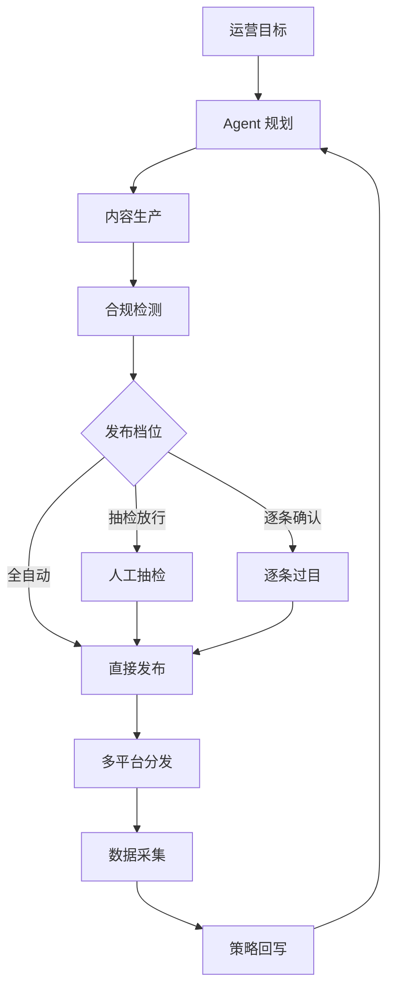

# AI 社媒 SaaS 产品需求文档

状态：草案
日期：2026-08-29
适用范围：国内平台，通用场景（非垂类）
首个需求样本：威吉瑞（广东）企业服务集团有限公司
文档性质：内部产品文档，不对外

---

## 一、产品定位

### 1.1 一句话定位

面向国内中小团队的 AI Agent 原生社媒矩阵工作台。给一个运营目标，Agent 自动完成拆解、生产、送审、发布与复盘，人在关键节点把关。

### 1.2 目标空位

按「AI 原生程度」和「团队规模与管控复杂度」两个维度划分，现有玩家的分布如下：

| 玩家 | AI 原生程度 | 服务对象 | 实质 |
|---|---|---|---|
| Buffer | 外挂式 AI 助手 | 小团队、个人 | 轻量排期工具 |
| 扣子 | 工作流可编排 | 个人创作者、小工作室 | 柔性自动化，非社媒专用 |
| 优采云 | AI 内容工厂 | 中小团队、个人创作者 | 偏内容生成与分发 |
| SocialEcho | AI 生成较完整 | 出海品牌、跨境电商 | 多平台工作台（出海） |
| 矩阵通（新榜） | AI 辅助 | 政企、大型集团 | 企业级矩阵管控，重合规与考核 |
| Hootsuite / Sprout Social | 外挂式 AI | 大型企业 | 老牌管理套件，价格高 |

空位在右中部：**AI 原生程度高，但服务对象是中小团队**。

右上角那批（矩阵通、Hootsuite）功能全但笨重，AI 只是外挂按钮，且价格和组织复杂度都超出中小团队承受范围。左下角那批（Buffer、扣子）轻巧便宜，但 AI 只是辅助，做不到"给目标就出活"。中间的中小团队（5 到 50 个账号）既需要企业级的能力，又付不起、用不来企业级产品。这个断层就是切入点。

### 1.3 目标客户

三类客户都做，但起步优先级不同。

| 客户类型 | 典型规模 | 核心痛点 | 付费意愿 | 起步优先级 |
|---|---|---|---|---|
| 代运营代理商 | 管 20 到 200 个客户账号 | 账号多、人少、交付压力大 | 强，直接关联产能与毛利 | 高 |
| MCN / 内容工作室 | 管 10 到 100 个达人或品牌号 | 内容量产、爆款复制 | 强，内容即收入 | 高 |
| 中小企业自运营 | 管 3 到 20 个号 | 没人专职做、不懂怎么做 | 中，需教育成本 | 中 |

**为什么代理商和 MCN 优先**：账号密度高，单点价值大；付费直接与产能挂钩，ROI 好算；决策链短（老板或业务负责人一人拍板）；一旦用起来迁移成本高，留存好。中小企业自运营是长期大盘，但前期获客和教育成本高，适合产品成熟后放量。

### 1.4 明确不做

以下能力在 MVP 及可预见的短期范围内不做，避免与矩阵通等企业级产品正面消耗：

- 企业级组织架构、多级权限与审批流
- 团队绩效考核与运营榜单
- 舆情监测、社媒聆听
- 全平台覆盖（先做三个平台）
- 代运营服务本身（我们卖工具，不卖人力）
- CRM 与客户管理（与社媒线索的打通放二期）

---

## 二、市场与竞争

### 2.1 市场现状

国内企业新媒体矩阵运营已成常态。行业数据显示，超七成中大型企业已布局 3 个及以上平台矩阵，同时约 85% 的企业仍存在明显运营瓶颈，集中在五个方面：

1. 多账号分散，规模化管控难
2. 内容创作成本高，优质内容无法复用
3. 数据统计繁琐，人工汇总占大量工时
4. 团队运营缺乏量化考核
5. 合规风控薄弱，限流封号风险高

工具选型的需求已从早期的"消息聚合、客服回复"转向"矩阵管控、AI 提效、内容资产沉淀、合规兜底"的全链路。这意味着市场已经教育完成，不需要我们再花力气说服客户"该用工具"，但同时也意味着客户会拿成熟产品来对比，功能 Baseline 不能太低。

### 2.2 我们的差异化

不与 incumbents 比功能齐全度，比的是代际。三根支柱：

**支柱一：Agent 化生产**

现有工具的 AI 是外挂式的：你在排期工具里点一个"AI 帮我写"按钮，本质还是人主导每一步。我们的差异是给 Agent 一个目标，它自己往下拆。

输入："这个月推新品 X，30 条内容，主打获客。"
Agent 输出：内容日历、选题分配、各平台适配版本、素材需求清单。
人只做三件事：确认方向、抽检内容、放行发布。

从"工具"变成"数字员工"，这是可以拉开代差的地方。

**支柱二：可控自动化**

市面上的产品普遍把"全自动发布"当卖点。但真实情况是，任何正经做品牌的团队都不敢全自动，因为一次限流或封号的代价远大于省下的人力。威吉瑞明确提出"养号期人工发布，避免平台限制"，这不是财税行业特有，是通用顾虑。

把合规与可控做成一等公民，而不是附属功能。具体见 4.3 节的三档信任机制。

**支柱三：内容资产复用**

现有工具的流程到"发布出去"就结束了。我们的观点是发布只是中间态，内容应该沉淀为可复用资产，数据应该回流驱动下一轮生产。

这一点不只是功能卖点，更是成本结构的刚需，详见 6.4 节的成本测算。

---

## 三、需求样本：威吉瑞

### 3.1 原始需求

来源：`BootX-ANC/knowledge/新媒体运营分工边界.md` 及 2026-08-19 现场会议记录。

| 需求项 | 客户原话含义 |
|---|---|
| 自有员工主导运营 | 公众号、视频号、网站由威吉瑞团队自己运营，不接受代运营 |
| 要 AI 加快内容生产 | 提到用豆包出文案、即梦出视频 |
| 需要素材处理 | 批量去水印、简单剪辑 |
| 账号与产量 | 计划 5 到 10 个账号，每天 2 到 3 条，约 30 条/天 |
| 投放渠道 | 企业微信、视频号等 |
| 目的 | 前期以曝光获客为主，短 AI 视频十几秒即可 |
| 发布方式 | 养号阶段建议人工发布，避免平台限制 |
| 我方边界 | BootX 提供工具支持，不接管运营 |

对应的商务状态：报价单第 08 项「AI 自媒体」，价格待定、不计入一期总价。截至 2026-08-29，威吉瑞一期项目客户已口头叫停，本项目不依赖该客户成交。

### 3.2 需求到功能映射

| 客户需求 | 产品功能 | 支柱归属 |
|---|---|---|
| 5 到 10 个账号，每天 30 条 | 矩阵账号管理、批量排期、错峰发布 | 支柱二 |
| 豆包出文案 | AI 文案生成（多模型路由） | 支柱一 |
| 即梦出视频 | AI 短视频生成（口播稿或图文成片） | 支柱一 |
| 批量去水印 | 素材批处理工具链 | 支柱一 |
| 简单剪辑 | 模板化轻剪辑 | 支柱一 |
| 投企微、视频号 | 渠道适配器 | 支柱二 |
| 养号期人工发布 | 三档信任机制、人工确认队列 | 支柱二 |
| 曝光获客 | 数据看板、效果归因 | 支柱三 |

### 3.3 通用性判断

逐条判断哪些是通用需求，哪些是行业特有的：

| 需求 | 是否通用 | 判断依据 |
|---|---|---|
| 多账号矩阵管理 | 通用 | 所有矩阵运营的基础能力 |
| AI 文案与视频生成 | 通用 | 已是行业 Baseline |
| 素材批处理 | 通用 | 但优先级低于生成与发布 |
| 批量排期与错峰 | 通用 | 防限流的通行做法 |
| 养号期人工发布 | 通用 | 任何品牌方的共同顾虑，非财税特有 |
| 内容需体现专业度 | 半通用 | 专业服务业更强，但消费品牌同样要求调性一致 |
| 线索回流 CRM | 非通用 | 部分客户已有 CRM，放二期做成可选集成 |

结论：威吉瑞的需求中，**绝大部分是通用需求**。这支持了做通用产品而非垂类的判断。行业特有部分（专业度、合规话术）不通过内置垂类知识解决，而是通过 4.5 节的可选知识源接入来解决。

---

## 四、产品架构与功能模块

### 4.1 总体架构

分层说明：

| 层 | 职责 | 技术要点 |
|---|---|---|
| 接入层 | 平台账号授权、数据采集 | 官方 OAuth 优先，RPA 兜底（二期） |
| Agent 层 | 目标拆解、内容生产、质检、策略回写 | 自研编排，模型走外部 API |
| 分发层 | 排期、合规、发布、熔断 | 平台适配器、规则引擎 |
| 资产层 | 素材库、内容版本、数据 | 对象存储、向量检索 |

### 4.2 模块一：Agent 内容生产

**4.2.1 目标到内容日历**

输入运营目标（推广对象、周期、内容量、目标平台、调性要求），Agent 输出可直接执行的内容日历。每一条包含：选题、角度、平台、形式（图文或视频）、发布时段、素材需求。

关键设计：日历必须可编辑。Agent 给的是初稿，人可以在日历上直接增删调序，而不是接受一个黑箱结果。

**4.2.2 内容生成**

三类生成器，全部走外部模型 API：

- 文案生成：多模型路由（见 6.2），支持品牌调性约束、字数与结构约束
- 图片生成：文生图、图生图
- 视频生成：口播稿转视频、图文成片，10 到 30 秒为主

**4.2.3 素材处理**

批量去水印、格式转换、尺寸适配、简单剪辑（拼接、字幕、BGM）。这块技术门槛不高，但威吉瑞明确提到，属于客户能直观感知的功能点。

**4.2.4 质量自检**

生成后先过一遍自检，不直接送人审：事实一致性（是否偏离输入材料）、平台规范（字数、图片比例、话题标签）、敏感词与违规风险、重复度（与历史内容去重）。自检不通过的直接回炉重生成，不占用人工审核带宽。

### 4.3 模块二：可控自动化发布引擎

这是产品的核心差异，也是"不封号"卖点能否成立的关键。

**4.3.1 三档信任机制**

| 档位 | 适用场景 | 流程 |
|---|---|---|
| 全自动 | 成熟账号、低风险内容、客户已信任系统 | 生成 → 自检 → 发布 |
| 抽检放行 | 日常主力模式，系统默认 | 生成 → 自检 → 人抽看若干条 → 批量放行 |
| 逐条确认 | 新号、养号期、高风险行业、高危内容类型 | 每条人工过目后放行 |

档位可以按账号、按内容类型、按时间段分别配置。例如某客户的视频号走抽检放行，但新开的三个小号走逐条确认。

**4.3.2 平台规则库**

维护各平台的内容规范与风险规则：字数与尺寸限制、话题标签规范、违禁词与敏感表述、发布频率阈值、外链与导流限制。规则库需要持续运营，这是长期成本，但也是竞品难以快速复制的壁垒。

**4.3.3 节奏控制与熔断**

- 错峰发布：同一账号多条内容之间、不同账号之间的时间间隔随机化，避免机械规律
- 频率上限：按平台与账号设置日发布上限
- 异常熔断：检测到发布失败、内容被删、账号限流、互动异常下降时自动降速或暂停，并告警

**4.3.4 人工确认队列**

审核界面按风险排序，高风险排前面；支持批量操作（通过、打回、改写后重提）；支持打回时给出原因，原因回流进 Agent 的策略权重。

### 4.4 模块三：内容资产与数据闭环

**4.4.1 一稿多平台裂变**

一条母内容自动改写为各平台适配版本：抖音的快节奏脚本、小红书的种草体与标签、公众号的长图文、视频号的转发语。

这一点的商业价值被低估了。见 6.4 节测算：裂变能显著降低内容生成成本，因为这不只是功能体验，而是毛利结构的关键。

**4.4.2 素材库**

素材沉淀、自动打标、向量检索、去重。历史素材可以被新内容重新调用，避免重复生成。

**4.4.3 爆款识别与二次放大**

识别数据表现显著高于该账号基线的內容，触发加推、改写重发、跨平台迁移。

**4.4.4 策略回写**

按内容类型、选题、发布时段、平台维度归因效果，自动加权下月选题。例如系统发现该账号的"政策解读"类内容互动率 consistently 高于"公司介绍"类，下月日历自动提高前者的占比。

### 4.5 可选模块：企业知识源接入

不做垂类内置知识，但允许客户接入自有知识源，作为可选项：

- 支持来源：Notion、飞书文档、企业 Wiki、FAQ 文档、产品手册、历史内容库
- 不接也能正常使用，用通用模型能力生成
- 接了之后，内容生产优先从知识源取材，并可标注引用来源供人工核对

价值：通用客户不被强绑，深度客户（如威吉瑞这类专业服务机构）仍能拿到专业度与一致性。这是把原本的垂类差异化降级为通用可配置项。

**重要护栏**：AI 生成内容必须经人工审核后才能发布。这一条要写进产品默认值，不可被客户关闭到完全无人审核。

---

## 五、平台适配策略

### 5.1 各平台接口现状

| 平台 | 官方接口开放度 | 发布能力 | 风险 |
|---|---|---|---|
| 微信公众号 | 较开放 | 支持素材与图文发布、定时 | 低 |
| 视频号 | 较开放（依赖微信生态授权） | 支持发布 | 低到中 |
| 企业微信 | 开放 | 支持消息推送、客户群 | 低 |
| 抖音 | 有开放平台，但内容发布权限受限 | 部分受限，需申请资质 | 中 |
| 小红书 | 最封闭 | 官方无内容发布开放接口 | 高（多数工具走 RPA） |
| B站 / 快手 / 微博 | 中等 | 支持程度不一 | 中 |

### 5.2 核心风险

平台适配是这个产品的生死线，也是最容易翻车的地方。

最大的矛盾在于：**我们的核心卖点是"不封号"，但如果为了覆盖小红书而采用 RPA 模拟登录发布，这本身就显著提高封号风险，卖点与实现会自相打架。**

因此策略必须明确：MVP 阶段只做官方接口可用的平台，RPA 平台放二期，且届时要在产品内显著标注风险等级，由客户自行选择是否启用。

### 5.3 MVP 平台选择

建议 MVP 做三个：

1. **视频号**：官方接口可用，且是中小企业与品牌私域的核心阵地
2. **公众号**：接口成熟稳定，内容形态标准化
3. **企业微信**：作为分发与私域承接渠道，而非公域发布渠道

抖音与小红书放 P1，需要先解决资质申请与接口授权问题。这个选择会牺牲一部分市场覆盖面（小红书在消费品牌领域需求很大），但换取的是"不封号"这个核心卖点的可信度。

如果后续决定优先服务消费品牌客户，这个优先级需要重新排，因为小红书对他们是刚需。

---

## 六、技术方案

### 6.1 模型能力套 API，Agent 编排自研

这是两件必须分开看的事。

**第一件：模型能力走第三方 API，不自建。**

不自己训练、不自己部署大模型，内容生成直接调用现成服务：

| 能力 | 候选服务 |
|---|---|
| 文案生成 | DeepSeek、豆包、通义千问、Kimi |
| 图片生成 | 即梦、通义万相 |
| 视频生成 | 即梦、可灵、海螺 |

不自建的理由：

1. 成本：训练或微调一个可用的模型，投入在数十万到数百万量级，且需要持续的算法与算力团队
2. 过时速度：模型能力每 1 到 3 个月迭代一代，自建模型上线即落后，且需持续跟进
3. 不是护城河：模型能力对所有人同等可得，客户不会因为"你有自己的模型"而付费
4. 灵活路由：接入多家可以按需择优调用，还能规避单一供应商涨价、限流或服务下线

**第二件：Agent 编排必须自研。**

这一层没有任何现成 API 能替代，它就是产品本身，也是护城河所在：

- 目标到内容日历的拆解逻辑
- 多平台内容的适配与改写策略
- 合规规则库与风险分级
- 发布节奏控制与异常熔断
- 数据反馈到选题的加权回写

一句话总结：**模型是水电煤，买；编排是房子，自己盖。**

### 6.2 多模型路由

按任务类型路由到不同模型，而不是锁定一家：

| 场景 | 路由策略 | 目的 |
|---|---|---|
| 批量草稿生成 | 便宜模型 | 控成本 |
| 精品内容、品牌调性要求高 | 强模型 | 保质量 |
| 敏感行业内容 | 合规性更好的模型 | 降风险 |
| 供应商异常 | 自动切换备用 | 保可用 |

抽象一层统一的模型网关，上层业务不感知具体供应商，供应商可热切换。这是套 API 相对自建的重要优势。

### 6.3 需要自研的核心组件

| 组件 | 说明 |
|---|---|
| Agent 编排引擎 | 目标拆解、任务调度、状态管理、失败重试 |
| 平台适配器 | 各平台授权、内容格式转换、发布、数据拉取 |
| 规则引擎 | 合规检测、风险分级、熔断策略 |
| 内容资产库 | 存储、打标、向量检索、去重 |
| 调度器 | 排期、错峰、节流 |
| 数据归因 | 多维度效果统计与策略回写 |

### 6.4 成本模型

**这一节是定价的基础，所有数字为预估值，上线前必须实测校准。**

单位成本预估：

| 项 | 单位成本 |
|---|---|
| 文案生成（约 500 输出 token） | ¥0.01 到 0.05 / 条 |
| 图片生成 | ¥0.1 到 0.3 / 张 |
| 视频生成（10 到 15 秒） | ¥0.5 到 2.0 / 条 |
| 存储与带宽 | ¥50 到 300 / 月 / 客户 |
| 服务器与数据库（多租户摊薄后） | ¥300 到 800 / 月 |

重度用户测算（以威吉瑞 900 条/月为例，60% 为视频）：

- 视频 540 条 × ¥1.0 = ¥540
- 图片 900 张 × ¥0.2 = ¥180
- 文案 900 条 × ¥0.03 = ¥27
- 内容成本合计约 ¥747/月，加基础设施约 ¥950 到 1,050/月

**结论一：内容生成是变动成本，且量级不小。**

如果按固定月费无限量售卖，重度用户会直接击穿毛利。市面上那个约 4000 元/年的竞品采用"SaaS 年费 + token 另计"，正是因为如此。这不是他们定价技巧差，是成本结构决定的。

**结论二：一稿多平台裂变是毛利的关键。**

同样是 900 条分发量，若改为生成 300 条母内容再裂变：

- 母内容 300 条（含 180 视频）：180 × 1.0 + 300 × 0.2 + 300 × 0.03 ≈ ¥249
- 裂变改写 600 条 × ¥0.02 ≈ ¥12
- 合计约 ¥261/月

成本下降约 65%。这说明支柱三不是锦上添花，而是成本结构上的刚需。产品应主动引导客户使用裂变，例如在生成流程中默认走"母内容 + 多平台版本"，而不是每个平台单独生成。

---

## 七、商业与定价

### 7.1 定价结构

采用「订阅费 + 内容点数」双层结构：

- 订阅费覆盖平台功能、账号额度、基础设施
- 内容点数覆盖模型调用成本，按实际消耗计

点数定义（建议初值，需按实测成本校准）：

| 内容类型 | 点数 |
|---|---|
| 文案 1 条 | 1 点 |
| 图片 1 张 | 3 点 |
| 视频 1 条 | 15 点 |
| 裂变改写 1 条 | 1 点 |

### 7.2 分档

| 档位 | 年费 | 账号数 | 含点数/月 | 目标客户 |
|---|---|---|---|---|
| 入门版 | ¥1,980 | 5 | 300 | 个人、小团队试水 |
| 基础版 | ¥4,980 | 15 | 1,000 | 中小企业自运营 |
| 专业版 | ¥9,800 | 40 | 3,000 | MCN、成长型团队 |
| 代理版 | ¥19,800 | 100 | 8,000 | 代运营代理商 |

超出部分按 ¥0.08 到 0.10 / 点计费，或购买点数包。

### 7.3 毛利校验

基础版（¥4,980/年，约 ¥415/月，含 1,000 点）典型用法：

- 用量：100 条/月（30 视频、100 图、100 文案）
- 消耗点数：30×15 + 100×3 + 100×1 = 850 点（在额度内）
- 成本：30×1.0 + 100×0.2 + 100×0.03 + 基础设施约 ¥100 ≈ ¥153/月
- 毛利约 63%

专业版（¥9,800/年，约 ¥817/月，含 3,000 点）典型用法：

- 用量：300 条/月（100 视频、300 图、300 文案）
- 消耗点数：100×15 + 300×3 + 300×1 = 2,700 点（在额度内）
- 成本：100×1.0 + 300×0.2 + 300×0.03 + 基础设施约 ¥150 ≈ ¥319/月
- 毛利约 61%

**重度视频用户毛利明显偏低。** 以 900 条/月（540 视频）为例，点数消耗约 11,700，即便走代理版仍需额外购买约 3,700 点（约 ¥370/月），总成本约 ¥947/月，对应收入约 ¥2,020/月，毛利降至 53% 左右。

优化路径三条：

1. 引导使用裂变降低生成量（效果最显著）
2. 视频生成批量议价，或接入更便宜的视频模型
3. 对超重度用户考虑私有化部署或专属资源池，单独报价

这一条需要持续跟踪，是商业模式里最脆弱的环节。

---

## 八、MVP 范围与排期

### 8.1 P0（MVP，建议 3 个月）

| 模块 | 范围 |
|---|---|
| 账号管理 | 视频号、公众号、企业微信授权与管理，支持 5 到 50 账号 |
| Agent 规划 | 输入运营目标，输出可编辑的内容日历 |
| 内容生产 | 文案生成（多模型路由）、图片生成、视频生成 |
| 素材处理 | 批量去水印、格式适配、模板化剪辑 |
| 合规检测 | 敏感词、平台规范、重复度自检 |
| 发布引擎 | 三档信任机制、人工确认队列、错峰与频率控制、异常熔断 |
| 裂变 | 一稿多平台改写 |
| 数据 | 基础看板（发布量、曝光、互动）、按内容与时段归因 |

### 8.2 P1

- 抖音、小红书适配（需先解决授权与资质）
- 策略回写自动化（数据驱动选题加权）
- 素材库向量检索与去重
- 爆款识别与二次放大
- 企业知识源接入（Notion、飞书、Wiki）
- 评论与私信的 AI 辅助回复
- 线索导出与 CRM 集成

### 8.3 P2

- 全平台覆盖
- 团队协作与权限（轻量版，非企业级组织架构）
- 竞品监测、热点追踪
- 客户成功与运营模板库

### 8.4 排期建议

| 阶段 | 周期 | 目标 |
|---|---|---|
| 阶段一 | 4 周 | 平台授权打通 + 单账号发布闭环跑通 |
| 阶段二 | 4 周 | Agent 规划与内容生产接入，人工确认发布 |
| 阶段三 | 4 周 | 裂变、合规检测、熔断、数据看板 |
| 阶段四 | 2 周 | 内测与真实客户试点（可考虑威吉瑞为首个试点） |

---

## 九、风险与开放问题

| 风险 | 等级 | 说明与应对 |
|---|---|---|
| 平台接口政策变化 | 高 | 平台随时可能收紧授权或调整规则。应对：优先官方接口，抽象适配层，避免深度绑定单一平台 |
| 内容生成成本超预期 | 高 | 视频生成单价波动大。应对：上线前实测校准，定价与点数规则保留调整空间 |
| 重度用户击穿毛利 | 中 | 见 7.3。应对：引导裂变、批量议价、超重度客户单独报价 |
|  incumbents 快速跟进 Agent 能力 | 中 | 矩阵通等有资源快速补齐。应对：速度优先，把 Agent 编排与规则库做深 |
| 平台适配工程量大 | 中 | 每加一个平台都是不小的工作量。应对：MVP 只做三个，验证后再扩展 |
| 客户期望"全自动" | 中 | 部分客户就是想要全自动，会嫌人工确认麻烦。应对：档位可选，但不开放到完全无人审核 |

### 开放问题

1. 小红书到底做不做？消费品牌客户是刚需，但只能走 RPA，与"不封号"卖点冲突
2. Agent 规划的输入形态：结构化表单还是自然语言对话？影响上手门槛与实现复杂度
3. 是否需要提供"内容托管"的轻量人工服务作为高端档位？会模糊 SaaS 边界
4. 是否接入企业微信作为私域承接的一等公民？这会显著增加产品复杂度

---

## 十、待决策

| 编号 | 决策项 | 影响 |
|---|---|---|
| D1 | 小红书是否纳入 MVP | 影响目标客户范围与核心卖点可信度 |
| D2 | 起步客群侧重代理商 / MCN，还是中小企业自运营 | 影响获客路径与功能优先级 |
| D3 | 定价点数与超量单价的最终取值 | 需在成本实测后校准 |
| D4 | 是否以威吉瑞作为首个试点客户 | 影响验证速度与产品打磨方向 |
| D5 | 团队投入规模与资金来源 | 决定排期可行性 |

---

## 附录：需求来源

- 威吉瑞社媒需求：`BootX-ANC/knowledge/新媒体运营分工边界.md`
- 威吉瑞会议记录：`BootX-ANC/archive/2026-W34-20260819-evan-郭玥-威吉瑞方案报价展示沟通记录.md`
- 方案规划书改动：`BootX-ANC/knowledge/威吉瑞方案规划书更新版核心改动.md`
- 市场调研：2026 年 AI 社媒矩阵管理工具公开评测与竞品资料（矩阵通、优采云、扣子、SocialEcho、Buffer、Hootsuite、Sprout Social）
