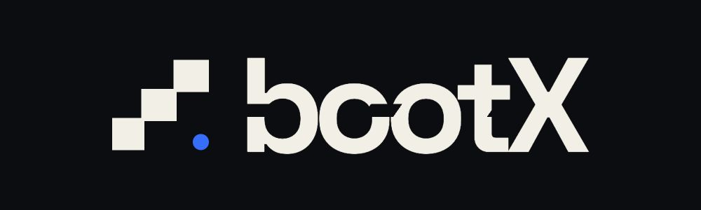

<p align="center">
  
</p>

# BootX 内部 ANC 知识库

> BootX 团队的 AI Native Company（ANC）内部知识中枢 · Lite 模式（文件共享）
> 设计依据：ANC 知识飞轮机制 + Akasha 三层记忆架构（三层用「标签」区分，不用「目录」）
> 定位：**Agent 无关**——纯 Markdown + Git，任何 Agent 可读可写

---

## 这是什么

BootX 团队用任意 Agent（Codex / WorkBuddy / Trae / Cursor 等）做完工作后，把**产出物**（文档、方案、代码、分析报告、复盘）丢进 `00_inbox/`。每周跑一次 AI 清洗，把零散产出提炼成结构化知识，沉淀进 `knowledge/`（按 Akasha 三层打标签），并逐步固化为可复用的 Agent 技能。

**一句话：个人知识回流到团队，形成持续进化的飞轮。**

> 没有回流的 AI 是高级一次性筷子，有回流的 AI 才是公司资产。

---

## 飞轮怎么转

```
团队成员用任意 Agent 工作
   │ 产出物丢进 00_inbox/
   ▼
每周自动清洗（见 _automation/weekly-clean-prompt.md）
   │ 提取方法论 / 决策权衡 / 踩坑 / 内部实体
   ▼
沉淀进 knowledge/（每条知识带 layer 标签）
   ├─ layer: facts        发生了什么（文档、会议、代码、工单）
   ├─ layer: interactions  为什么重要（决策、分歧、权衡、假设）
   └─ layer: actions       下一步做什么（SOP、工作流、技能、护栏）
   │
   ▼
knowledge/YYYY-Www.md 聚合本周知识条目（周报）
   │
   ▼
被验证有效的知识 → skills/ 固化为 Agent 技能，分发全员
   │
   ▼
下一次 Agent 工作能直接命中团队知识 → 更好用 → 更多用 → 飞轮加速
```

实测参考（NGS AI Center）：RAG 命中率第一周约 5%，第四周 30%，第八周 60%。

---

## 目录结构

| 目录 | 用途 |
|------|------|
| `00_inbox/` | **投递区**：所有人把本周产出物丢这里，清洗前不归类 |
| `knowledge/` | **核心知识库**：结构化知识条目 + 每周周报。Akasha 三层用 frontmatter 的 `layer` 字段区分，不拆目录 |
| `skills/` | **技能源仓库 + 候选评审**：被验证的知识固化来源，存中性的 `SKILL.md`，各 Agent 各自挂载 |
| `archive/` | 已清洗的原始产出物归档（从 `00_inbox/` 移入，保留溯源） |
| `_templates/` | 投递模板、知识条目模板 |
| `_automation/` | 每周清洗 Prompt 与运行说明 |

> 为什么三层不拆目录：目录越少，投递和检索摩擦越小。事实/交互/行动是「分类法」，不是「文件夹」。

---

## 怎么用（每人每周 2 分钟）

1. 用任意 Agent（Codex / WorkBuddy / Trae 等）做完一项有复用价值的工作。
2. 把最终产出物（或关键片段）按 `_templates/inbox-submission.md` 格式丢进 `00_inbox/`。
3. 命名：`YYYYMMDD-作者-主题.md`（例：`20260817-evan-威吉瑞报价模型.md`）。
4. **不用做别的**——每周清洗自动化会处理 `00_inbox/`，提炼后把原始文件移到 `archive/`。

> 门槛不在技术，在于把"知识回流"当基础设施。哪怕只采集到 30%，也比完全不采集强。

---

## 多 Agent 团队怎么协作

BootX 团队不止用一个 Agent，所以知识库刻意设计成 **Agent 无关**：

- **采集**：不管用哪个 Agent 干活，产出物都是文件——丢进 `00_inbox/` 即可，不依赖任何工具的日志接口。
- **沉淀**：知识统一存成纯 Markdown（`knowledge/`），任何 Agent 都能读。
- **消费**：各 Agent 用自己的检索方式命中知识——Codex 读 codebase、WorkBuddy 全文检索、Trae/Cursor 搜项目文件。团队 >5 人后再接统一向量库（Phase 2）。
- **技能**：`skills/` 存中性 `SKILL.md`，各 Agent 各自挂载（见 `skills/README.md`）。

一句话：**文件系统就是知识库，Git 就是同步层，Agent 只是读写这个仓库的工具之一。**

---

## 阶段边界（当前能力 / 下一步）

| 阶段 | 检索方式 | 状态 |
|------|---------|------|
| **Phase 1（当前）** | Git + 各 Agent 各自检索，直接读 `knowledge/` | ✅ 已就绪 |
| **Phase 2（团队 >5 人时）** | 接统一向量索引（LanceDB / Chroma），语义检索 RAG | 🔲 未启动 |
| **Phase 3（长期）** | 统一 Agent 入口 + Gateway 日志采集，替代人肉投递 | 🔲 未启动 |

**当前边界**：知识靠 Git 共享 + 各 Agent 各自检索。不追求技术完美，先跑起来看飞轮有没有转。

---

## 团队协作（Git）

- 本仓库是团队共享知识中枢，通过 Git 同步。
- 投递：直接把文件放进 `00_inbox/` 后 `commit + push`（或提 PR）。
- 清洗：由每周自动化统一执行，产出的知识条目经提交进入主分支。
- 敏感数据：客户/财务等敏感内容不进本仓库，或脱敏后入库。

详见 `CONTRIBUTING.md`。
