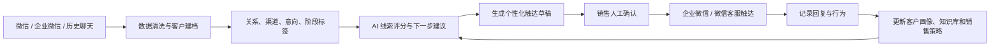

# AI咨询｜企业私域销售工作台需求与解决方案

> 文档性质：客户需求整理与解决方案初稿  
> 适用对象：留学机构负责人、销售负责人、产品经理、AI 解决方案工程师  
> 当前状态：Proposal，需在客户访谈和数据样本验证后进入 PRD

## 1. 结论先行

客户真正想做的不是“给 Obsidian 加一个微信机器人”，而是一套面向留学业务的 AI 私域销售工作台：

> 把微信关系资产结构化，自动识别潜客与转介绍机会，辅助销售精准跟进，并逐步接管重复性销售工作。

建议的产品定位是：

> **AI 私域增长与销售协同系统**

推荐的分工是：

- 企业微信负责正式、可审计的客户触达；
- CRM 或业务数据库负责客户状态、销售归属和跟进任务；
- Obsidian 负责知识沉淀、案例、话术和 Agent 规则；
- AI Agent 负责分析、推荐、生成草稿和执行低风险任务；
- 真人负责信任建立、复杂判断、谈判和最终成交。

## 2. 客户需求还原

### 2.1 客户明确提出的需求

客户聊天记录和截图中出现了以下需求：

1. AI Agent 能否嵌入微信或企业微信；
2. AI Agent 能否逐步替代部分留学销售工作；
3. 用 AI 驱动销售，替代低效率的传统群发海报；
4. 管理约 5000 个微信圈层好友；
5. 导入历史聊天数据；
6. 对联系人进行渠道、关系和客户分层；
7. 发现潜在客户和转介绍对象；
8. 用 Codex + Obsidian 构建自生长知识库；
9. 根据联系人画像和历史对话生成个性化回复；
10. 通过人工确认、评分和反馈不断改进 Agent。

### 2.2 截图中隐含的产品设想

客户发送的截图已经隐含了一个四层产品结构：

1. **建档**：为联系人生成关系画像、标签和关系图；
2. **拟真辅助沟通**：结合画像、历史聊天和销售个人话术生成回复草稿；
3. **人工确认**：销售确认后才发送，并把修改反馈回话术库；
4. **经营转化**：根据意向、互动、沉默时间和行为信号生成跟进任务。

这说明客户的核心诉求不是扩大群发数量，而是让微信好友从“看不见、跟不上、无法继承的关系资产”变成“可识别、可跟进、可复用的客户资产”。

## 3. 当前可行性与产品边界

### 3.1 企业微信：适合作为正式产品入口

企业微信官方能力覆盖：

- 外部联系人管理；
- 客户标签、备注和归属；
- 客户群管理；
- 微信客服；
- 客户朋友圈；
- 企业群发和欢迎语；
- 会话内容存档；
- API 消息收发；
- 微信客服机器人和知识库。

企业微信会话内容存档支持通过 API 获取已开启存档成员的工作沟通内容，但需要配置存档范围、IP 地址和加密公钥；涉及外部联系人时，需要取得对方同意。详见[企业微信会话内容存档说明](https://open.work.weixin.qq.com/api/doc/90000/90135/91774)和[会话同意情况接口](https://open.work.weixin.qq.com/api/doc/90000/91782)。

### 3.2 个人微信：按“人工辅助”处理

目前没有检索到个人微信公开、稳定、官方的“读取全部历史聊天 + 自动代聊 + 批量发送”接口。因此不应把以下能力作为正式产品承诺：

- 自动读取 5000 个个人微信好友的全部历史消息；
- 直接控制个人微信自动回复；
- 使用外挂、Hook、多开、模拟器或非官方协议作为商业基础设施。

个人微信可以作为：

- 用户主动导出的聊天数据来源；
- 截图、文本和文件的导入来源；
- AI 销售副驾驶的人工操作渠道；
- AI 生成建议后由销售复制或确认发送的渠道。

正式自动化触达应逐步迁移到企业微信、微信客服、公众号、小程序或 H5。

### 3.3 Obsidian：知识层，不是 CRM 数据库

Obsidian 适合保存：

- 留学知识库；
- 销售方法论；
- 高质量客户案例；
- 经过人工确认的对话范例；
- Agent 提示词和业务规则；
- 客户洞察和决策记录。

但联系人、客户阶段、任务、权限、销售归属和触达记录仍应保存在结构化数据库或 CRM 中。

更合理的定义是：

> CRM/数据库保存业务状态，Obsidian 保存可读知识和人工沉淀，AI 同时检索两者。

## 4. 产品方案

### 4.1 整体工作流

### 4.2 客户数据层

每个联系人至少应具备以下字段：

- 联系人身份：学生、家长、老客户、校友、合作方、朋友、未知；
- 来源渠道：自然添加、客户转介绍、活动、内容、微信群、销售个人关系；
- 关系强度：陌生、认识、熟悉、客户关系、合作关系；
- 留学阶段：未启动、探索期、选校期、申请期、签证期、已入学、已毕业；
- 目标国家、专业、预算、时间节点；
- 当前意向：无意向、潜在意向、明确咨询、高意向、已成交；
- 最近互动时间；
- 最近一次有效信号；
- 下一步动作；
- 是否允许营销触达；
- 是否允许聊天内容存档；
- 信息来源和证据。

AI 生成的每一个标签都应附带：

- 证据消息；
- 置信度；
- 生成时间；
- 是否经过人工确认。

### 4.3 客户分层

建议同时使用三种维度：

#### 身份层

- 学生；
- 家长；
- 老客户；
- 校友；
- 转介绍人；
- 合作方；
- 内容受众；
- 普通关系。

#### 意向层

- 无明确意向；
- 潜在意向；
- 主动咨询；
- 高意向未跟进；
- 已预约；
- 方案沟通；
- 已成交；
- 可转介绍；
- 不再触达。

#### 业务阶段层

- 关系资产；
- 沉睡联系人；
- 需求探索；
- 方案咨询；
- 申请执行；
- 签证或后续服务；
- 老客户维护；
- 转介绍节点。

### 4.4 AI 线索评分

第一版建议采用可解释评分，而不是直接使用黑盒模型：

- 业务匹配度：40 分；
- 主动意向信号：30 分；
- 时间紧迫度：15 分；
- 关系强度：10 分；
- 回复活跃度：5 分。

截图中的“高意向 100 分”可以保留为界面表达，但系统必须说明评分依据，不能只显示一个无法解释的分数。

### 4.5 AI Agent 功能

#### 第一阶段：销售副驾驶

- 历史聊天总结；
- 联系人自动标签；
- 潜客识别；
- 沉睡客户唤醒建议；
- 下一步跟进提醒；
- 个性化回复草稿；
- 咨询记录总结；
- 客户问题提取；
- 转介绍可能性识别；
- 销售每日跟进队列。

#### 第二阶段：企业微信协同自动化

- 企业微信客户标签同步；
- 新客户欢迎语；
- 微信客服机器人；
- 常见问题自动回答；
- 预约咨询；
- 会后自动跟进；
- 基于行为的跟进任务；
- 客户朋友圈内容建议。

#### 第三阶段：经营智能化

- 线索转化预测；
- 转介绍网络识别；
- 销售个人话术风格建模；
- 客户生命周期运营；
- 不同内容和触达策略的 A/B 测试；
- 由人工反馈驱动的话术和知识库迭代。

## 5. AI 对留学销售的替代边界

### 5.1 适合优先自动化

- 客户整理；
- 历史聊天总结；
- 客户分层；
- 线索评分；
- 首轮基础问答；
- 资料收集；
- 预约安排；
- 跟进提醒；
- 会后总结；
- 标准化内容发送；
- 沉睡客户唤醒建议；
- 转介绍机会发现。

### 5.2 需要人工确认

- 针对具体家庭的留学方案；
- 学校和专业建议；
- 申请成功概率判断；
- 预算和价格谈判；
- 家长异议处理；
- 高价值客户沟通；
- 复杂转介绍关系；
- 投诉、退款和风险场景。

### 5.3 必须保留真人

- 复杂家庭决策；
- 高金额成交；
- 签约和付款；
- 签证、法律、财务等高风险问题；
- 未成年人相关沟通；
- 客户信任建立。

行业实践更接近“AI 负责线索识别、触达准备和持续跟进，真人负责信任、判断、谈判和最终成交”。McKinsey 将生成式 AI 在销售中的方向概括为效率自动化、发现增长机会和重构销售流程；Salesforce 的 2026 销售报告也强调，Agent 的效果取决于统一、干净的客户数据。[McKinsey 销售研究](https://www.mckinsey.com/capabilities/growth-marketing-and-sales/our-insights/an-unconstrained-future-how-generative-ai-could-reshape-b2b-sales)、[Salesforce State of Sales 2026](https://www.salesforce.com/en-us/wp-content/uploads/sites/4/documents/reports/sales/salesforce-state-of-sales-report-2026.pdf)

## 6. Codex、Obsidian、CRM 和 Agent Runtime 的分工

### Codex

适合开发数据导入工具、维护 Agent 工作流、分析数据、迭代提示词和维护系统，不应被理解为线上客户服务运行时。

### Obsidian

适合管理留学知识、销售方法论、案例、对话范例、Agent 规则和客户洞察，是知识和判断沉淀层。

### CRM/数据库

负责联系人、客户状态、跟进任务、销售归属、来源、预约、成交、权限和审计。

### Agent Runtime

负责模型调用、检索、工具调用、任务编排、人工审核、消息发送和执行结果回写。

## 7. 推荐 MVP

第一版不建议直接接入全部 5000 个好友，建议先用一批可控样本验证：

1. 导入 500—1000 个联系人或一批历史聊天；
2. 自动清洗、去重和脱敏；
3. 自动生成联系人画像；
4. 自动分层和评分；
5. 展示评分证据；
6. 生成下一步跟进建议；
7. 生成个性化回复草稿；
8. 人工确认后发送；
9. 记录触达结果；
10. 将人工修改反馈回知识库。

### MVP 成功指标

- Top 50 高意向客户识别准确率；
- AI 标签人工修正率；
- 销售每天节省的整理时间；
- 跟进任务完成率；
- 有效回复率；
- 预约率；
- 转介绍线索数量；
- 退订、投诉和误触达率；
- AI 草稿采纳率。

核心指标不应是“发送了多少条”，而应是：

> 有效对话数、预约数、成交数和转介绍数。

## 8. 合规与数据安全

这类系统会处理聊天记录、姓名、联系方式、教育背景、家庭情况和预算，甚至可能涉及未成年人信息，应按高风险个人信息项目设计。

必须具备：

- 明确告知数据用途；
- 外部联系人聊天存档前取得同意；
- 提供拒绝营销和撤回同意入口；
- 数据最小化；
- 原始聊天加密保存；
- 发给模型前做脱敏；
- 不默认把客户聊天用于模型训练；
- 客户删除、导出和更正机制；
- 操作日志和权限审计；
- 销售人员按权限查看客户；
- AI 生成内容进行适当标识；
- 首次 AI 交互明确说明是 AI 助手或 AI 辅助。

《个人信息保护法》要求告知处理目的、方式、种类和保存期限；处理敏感个人信息需要更高保护要求；自动化营销应提供不针对个人特征的选项或便捷拒绝方式。[个人信息保护法](https://nmca.miit.gov.cn/zwgk/zcwj/flfg/art/2021/art_0bb3c8d9e620423fb4deeb85e1b751c5.html)

如果向公众提供生成式 AI 服务，还需要关注输入数据保护、个人信息处理和生成内容标识要求。[生成式人工智能服务管理暂行办法](https://www.cac.gov.cn/2023-07/13/c_1690898327029107.htm)、[人工智能生成合成内容标识办法](https://www.cac.gov.cn/2025-03/14/c_1743654684782215.htm)

## 9. 实施路线

### 阶段 0：数据和权限确认

- 明确个人微信与企业微信的比例；
- 确认聊天数据格式和可提供范围；
- 确认客户同意、员工告知和营销退出机制；
- 选取一批样本数据；
- 建立字段、标签和评分规则。

### 阶段 1：数据导入与客户建档

- 导入历史聊天和联系人；
- 清洗、去重、脱敏；
- 建立客户画像和关系结构；
- 生成初始分层和跟进队列。

### 阶段 2：AI 销售副驾驶

- 生成客户总结；
- 推荐下一步动作；
- 生成个性化草稿；
- 人工确认和结果回写；
- 评估评分准确率和跟进效率。

### 阶段 3：企业微信正式接入

- 对接企业微信客户联系；
- 对接客户标签；
- 对接微信客服；
- 对接会话内容存档；
- 建立消息、权限和审计链路。

### 阶段 4：转介绍与知识飞轮

- 识别老客户和校友关系；
- 识别潜在转介绍节点；
- 管理转介绍任务；
- 将高质量人工回复沉淀为知识；
- 用结果数据持续调整评分和 Agent 策略。

## 10. 详细客户汇报版本

以下内容可以直接作为第一次正式汇报的口头版本，也可以改成客户方案 PPT 的主体文案。

### 10.1 开场：我们对需求的理解

我们理解，您现在遇到的核心问题不是客户数量不够，而是已有的微信关系资产没有被有效经营。

您手上有大量微信好友和历史聊天，但目前存在几个问题：

- 不清楚哪些人是潜在客户、老客户、合作方或转介绍节点；
- 历史聊天很多，但没有形成可检索、可继承的客户画像；
- 传统群发海报触达范围大，但命中率、相关性和客户体验有限；
- 销售需要重复完成筛选、回忆上下文、写回复和安排跟进；
- 高意向客户可能因为没有及时跟进而流失；
- 已成交客户和校友的转介绍价值没有被系统化挖掘。

所以，我们建议建设的不是一个简单的群发工具，而是一套“AI 私域销售与关系资产工作台”。

### 10.2 我们建议解决的核心问题

这套系统主要解决四件事：

1. **看得见**：知道每个联系人是谁、来自哪里、和公司的关系是什么；
2. **跟得上**：知道谁最近有意向、谁需要唤醒、谁应该由销售优先跟进；
3. **说得准**：AI 根据历史关系、客户需求和业务知识生成个性化沟通草稿；
4. **能复利**：销售每次确认、修改和反馈，都会沉淀为下一次可以复用的知识和规则。

### 10.3 关于微信和企业微信的可行性结论

企业微信可以作为正式的系统接入渠道。它有客户联系、标签、微信客服、客户群、企业群发和会话内容存档等官方能力，适合承载后续的客户管理和自动化触达。

个人微信需要采取更谨慎的方式。我们不建议把个人微信外挂、多开或非官方协议作为正式产品基础，也不把“自动读取所有好友聊天并自动代聊”作为第一阶段承诺。

个人微信可以先通过用户主动提供的聊天导出文件、文本、截图或其他授权数据进行分析；AI 输出建议后，由销售人工确认和发送。对于需要稳定自动化的场景，建议逐步把客户沉淀到企业微信、微信客服、公众号、小程序或 H5 中。

### 10.4 我们建议的产品结构

这套系统由五部分组成：

- **数据层**：联系人、历史聊天、来源、标签、互动记录和客户阶段；
- **客户工作台**：客户画像、意向分数、证据、下一步动作和跟进队列；
- **AI 销售副驾驶**：总结、分层、评分、推荐、草拟回复和会后跟进；
- **知识库层**：Obsidian 中的留学知识、销售话术、案例和人工确认内容；
- **渠道层**：个人微信人工辅助、企业微信、微信客服、公众号、小程序和 H5。

Codex 更适合承担系统开发、数据处理、Agent 工作流维护和知识库整理；Obsidian 适合承担知识沉淀和人工审阅；CRM 或数据库负责真实的客户状态和销售流程。

### 10.5 第一阶段我们建议先做什么

我们不建议一开始就直接处理全部 5000 个好友，而是先选择一批可控样本，例如 500—1000 个联系人或一批有代表性的历史聊天。

第一阶段完成以下能力：

1. 导入和清洗历史数据；
2. 联系人去重和基础建档；
3. 识别客户身份、来源和关系强度；
4. 识别留学意向、国家、专业、预算和时间节点；
5. 生成高意向、沉睡客户和转介绍对象列表；
6. 为每个判断提供证据消息；
7. 推荐下一步跟进动作；
8. 生成符合历史关系和销售语气的回复草稿；
9. 由销售人工确认后发送；
10. 记录发送结果，并用人工反馈优化后续推荐。

第一阶段的目标不是证明 AI 可以完全替代销售，而是证明它可以让销售更快找到值得跟进的人，并减少大量重复整理工作。

### 10.6 后续扩展路线

当第一阶段验证有效后，再逐步增加：

- 企业微信客户标签同步；
- 企业微信会话内容存档；
- 微信客服机器人；
- 新客户欢迎语；
- 预约咨询和自动提醒；
- 会后总结和自动跟进；
- 客户朋友圈内容建议；
- 老客户和校友转介绍任务；
- 内容触达效果和销售转化分析。

### 10.7 AI 可以替代什么，不能替代什么

AI 可以先接管客户整理、线索筛选、聊天总结、基础问答、跟进提醒、标准化资料收集和回复草稿。

复杂的留学方案、学校和专业判断、家长异议、价格谈判、高价值客户沟通、签证和其他高风险问题，仍应由真人负责或至少经过人工确认。

我们的建议不是“用 AI 立刻替换销售”，而是：

> 先让 AI 接管低风险、高重复、可衡量的工作，再让优秀销售把时间投入到信任、判断和成交上。

### 10.8 项目成功的判断标准

项目是否成功，不以发送消息数量为主要指标，而看：

- 高意向客户识别是否准确；
- 销售筛选和整理客户所需时间是否下降；
- 跟进任务是否按时完成；
- 有效回复率是否提高；
- 咨询预约率是否提高；
- 老客户转介绍线索是否增加；
- 误触达、退订和投诉是否可控；
- 销售是否愿意持续使用并采纳 AI 草稿。

### 10.9 建议的下一步

我们建议先安排一次 60—90 分钟的需求确认会议，完成四件事：

1. 明确当前微信和企业微信的真实使用方式；
2. 查看一小批脱敏后的历史数据；
3. 确定第一阶段最重要的业务目标；
4. 共同确定试点范围、负责人和验收指标。

会议结束后，再输出正式 PRD、数据字段表、技术架构、实施排期和试点报价。

## 11. 需要跟客户沟通明确的问题

### 11.1 第一次会议必须确认的 12 个问题

这些问题会直接影响产品边界、数据方案和 MVP，建议优先问清楚。

1. **目前主要使用个人微信、企业微信，还是两者并用？**  
   需要知道每种渠道大约有多少联系人，以及哪些渠道是主要成交渠道。

2. **5000 个好友中，真正和留学业务有关的比例大约是多少？**  
   需要区分业务关系、私人关系、合作关系和无关联系人。

3. **目前是否已经有企业微信主体和管理员权限？**  
   如果没有，企业微信正式接入需要先完成主体、应用和权限准备。

4. **历史聊天数据现在以什么形式存在？**  
   例如文本导出、聊天记录文件、截图、语音、视频、Excel 联系人表或 CRM 数据。

5. **客户是否能够合法授权这些聊天数据用于分析和销售辅助？**  
   需要明确员工告知、外部联系人同意、客户撤回和删除机制。

6. **客户最想优先解决的是找潜客、唤醒沉睡客户，还是转介绍？**  
   第一阶段只能选择一个主目标，否则难以定义 MVP 成功。

7. **目前销售流程是什么？**  
   需要梳理从首次接触、需求沟通、预约、方案、签约到转介绍的实际步骤。

8. **谁负责最终判断客户是否值得跟进？**  
   是老板、销售主管、资深顾问，还是每个销售自行判断？

9. **哪些消息可以 AI 自动生成，哪些消息必须人工确认？**  
   尤其要明确价格、申请方案、录取判断、签证和未成年人相关场景。

10. **客户希望 AI 以什么身份出现？**  
    是明确说明为 AI 助手，还是只作为销售内部副驾驶？这会影响合规和产品体验。

11. **目前有没有 CRM、客户表格、企微标签或其他客户管理系统？**  
    需要确认谁是客户状态的真实来源，避免 Obsidian、CRM 和微信出现不一致。

12. **试点的预算、周期、负责人和验收指标是什么？**  
    没有明确负责人和验收标准，项目很容易停留在演示阶段。

### 11.2 业务目标问题

- 当前每月新增多少有效留学线索？
- 每月大约有多少首次咨询？
- 目前从好友到咨询、从咨询到签约的转化率是多少？
- 销售每周花多少时间整理聊天和客户资料？
- 目前最大的销售瓶颈是获客、筛选、跟进、成交还是转介绍？
- 客户更关心短期成交，还是长期私域资产管理？
- 是否有明确的国家、专业、预算或客群优先级？
- 是否有不希望触达的人群或明确的禁触达规则？

### 11.3 客户分层与评分问题

- 客户希望按照什么维度分层：身份、来源、国家、专业、预算、时间还是关系强度？
- 什么行为可以被定义为“高意向”？
- “看过内容但没有回复”是否算意向信号？
- 客户主动询问价格、学校或申请时间时，分别应该获得多少优先级？
- 老客户、校友、家长和学生的跟进策略是否不同？
- 转介绍人和直接客户是否需要两套不同的工作流？
- 客户是否愿意人工修正 AI 标签和评分？

### 11.4 沟通内容与品牌问题

- 客户希望 AI 使用什么语气：专业、朋友式、顾问式还是销售式？
- 是否有销售个人历史话术、优秀聊天案例和禁用表达？
- 哪些内容可以直接引用，哪些内容必须实时核验？
- 是否需要区分老板、资深顾问和普通销售的沟通风格？
- 是否允许 AI 主动询问客户需求，还是只能在客户先发消息后回复？
- 是否需要在消息中明确说明 AI 身份？
- 什么情况下必须转人工？
- 哪些关键词需要触发升级，例如投诉、退款、签证风险、价格异议或家长强烈不满？

### 11.5 数据与技术问题

- 历史聊天是否包含语音、图片、文件和视频？
- 是否需要对语音做转写、对图片做 OCR？
- 数据能否放在云端，还是必须本地部署或私有化部署？
- 是否允许使用第三方大模型处理脱敏后的聊天内容？
- 目前使用什么 CRM、表格、企业微信应用或知识库？
- Obsidian 是个人知识库，还是团队共享知识库？
- 是否需要多销售、多部门和多租户权限？
- 客户数据需要保存多久？
- 客户是否需要查看、更正、导出或删除自己的数据？
- 是否需要保留完整的 AI 推理、人工修改和消息发送审计记录？

### 11.6 试点和验收问题

- 第一批试点选择多少联系人？
- 试点由谁负责审核 AI 标签和回复？
- 试点周期是两周、一个月还是一个申请季？
- 试点期间是否允许 AI 自动发送，还是全部人工确认？
- 首个版本最重要的一个指标是什么？
- 需要和哪个历史周期或销售组进行对照？
- 什么结果可以判断继续投入？
- 如果 AI 误判客户或生成不合适的内容，谁负责处理？
- 客户希望购买软件、定制项目，还是“系统 + 运营服务”？
- 后续由客户团队自己运营，还是需要持续的 AI 运营和知识库维护服务？

### 11.7 建议会议结束时确认的决策

第一次会议结束时，至少要形成以下 8 个明确结论：

1. 第一阶段主渠道；
2. 第一阶段目标人群；
3. 第一阶段唯一主目标；
4. 可提供的数据样本；
5. AI 是否自动发送；
6. 试点负责人；
7. 试点周期和预算范围；
8. 成功和暂停标准。

如果这 8 项无法确认，建议暂时不要进入完整开发，而先做数据样本诊断和方案验证。

## 12. 相关页面

- [[AI咨询｜企业 AI 咨询公司的定位与落地方法论|AI咨询｜企业 AI 咨询公司的定位与落地方法论]]
